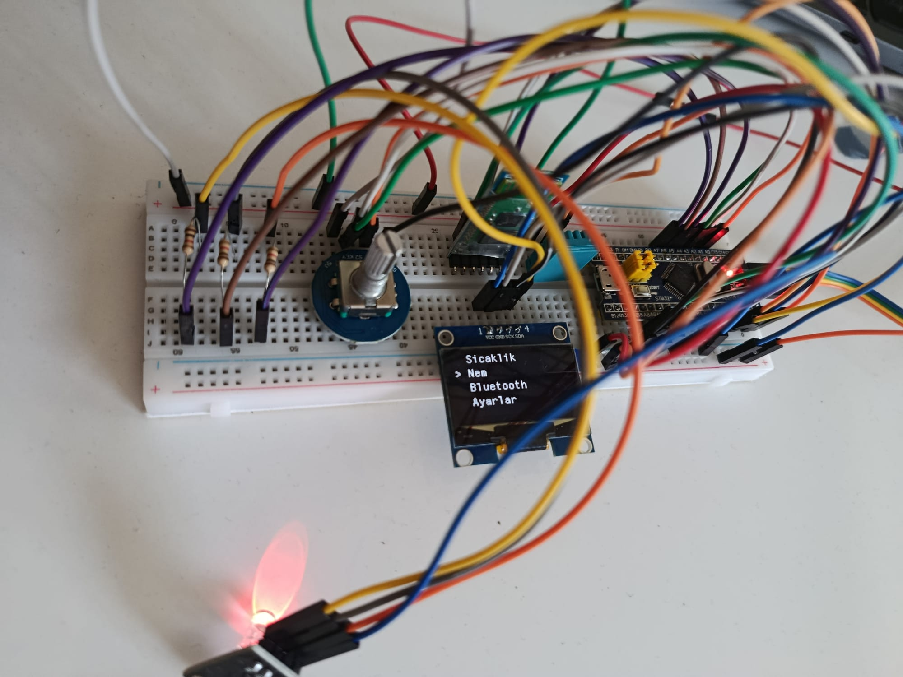
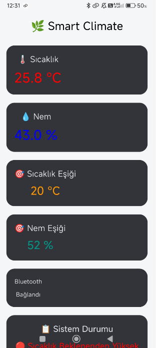
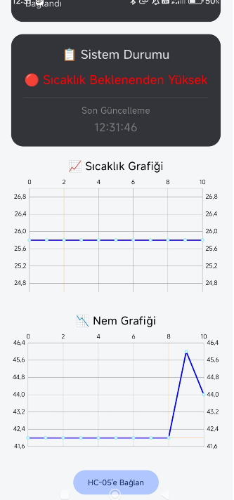

# STM32 Smart Climate System

An embedded climate monitoring and threshold control system built on an **STM32 Blue Pill (STM32F103C8T6)** using **STM32CubeIDE 1.18.0** and **STM32 ST-LINK Utility**, paired with a **Kotlin (Android Studio)** mobile application (**Smart Climate**).

## Features
- **Temperature & Humidity Sensing:** Reads live temperature and humidity values from the sensor.
- **Rotary Encoder Menu & Threshold Control:** Navigate the menu on the LED display, adjust temperature and humidity thresholds up or down, and save the selected threshold values.
- **RGB LED Status Combinations:** Outputs different RGB LED light combinations based on measured temperature and humidity relative to the configured thresholds.
- **Bluetooth Telemetry:** Sends live sensor readings, thresholds, and system status over Bluetooth to the **Smart Climate** Android app.
- **Smart Climate Mobile App (Kotlin):** Displays real-time temperature, humidity, threshold values, Bluetooth connection status, system alerts (such as high-temperature warnings), and live temperature/humidity charts.

## Tech Stack & Tools
- **MCU & Firmware:** STM32 Blue Pill (STM32F103C8T6), Embedded C, STM32CubeIDE 1.18.0, STM32 ST-LINK Utility
- **Hardware:** Temperature & Humidity Sensor, Rotary Encoder, LED Display, RGB LED, Bluetooth Module
- **Mobile App:** Android Studio, Kotlin

## Repository Structure
- `Core/` — Application source and header files (`main.c`, peripherals, interrupts, etc.)
- `Drivers/` — STM32 HAL and CMSIS drivers
- `Middlewares/` & `USB_DEVICE/` — Middleware and USB device stack files
- `Smart_Climate_App/` — Kotlin Android application (`Smart Climate`) for Bluetooth monitoring and charts
- `Sıcaklık ve Nem Full Proje.ioc` — STM32CubeMX hardware configuration
## Screenshots

